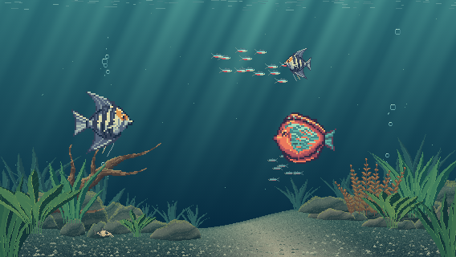
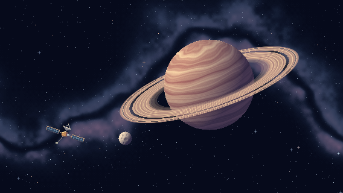

# Retro screensavers

Two animated pixel-art scenes for Windows, written in C and built on Linux. Each is a separate screen saver in the Windows picker. The artwork is drawn in code, so the two `.scr` files are all you need to copy.

| Glasswater Aquarium | Cassini Drift |
| --- | --- |
|  |  |
| Angelfish and discus wander through a planted freshwater tank. Schools of tetras pass at different depths, bubbles rise, and the current bends the leaves. | A survey probe crosses a slowly turning ringed world. Follow the cratered moon around its orbit and watch the planet cast a shadow across the rings. |

## Build on Linux

On Debian, Ubuntu, or Ubuntu under WSL:

```sh
sudo apt update
sudo apt install make gcc-mingw-w64-x86-64 binutils-mingw-w64-x86-64
git clone https://github.com/jsdyer/screensaver.git
cd screensaver
make
```

This produces **`build/aquarium.scr`** and **`build/space.scr`** for 64-bit Windows. The Makefile uses the same MinGW-w64 compiler and Win32 GDI approach as StarfieldSaver. `windres` embeds each saver's display name and settings dialog. Run `make build/space.scr` to build just the space scene.

Prebuilt copies are available from [Build screensavers](https://github.com/jsdyer/screensaver/actions/workflows/build.yml). Open a successful run and download the **windows-screensavers-x64** artifact.

## Try them on Windows

Copy the two files to your PC. To try one immediately, open PowerShell in that folder and run:

```powershell
.\aquarium.scr /s
.\space.scr /s
```

Run one command at a time. Move the mouse or press a key to exit. For both scenes to appear in the Windows picker, copy both files to `C:\Windows\System32` (administrator access required), search Start for **Change screen saver**, and select a scene. **Settings** offers slow, normal, and brisk animation. The choice is saved per scene for your Windows account.

The same executable handles the Windows switches used by StarfieldSaver:

| Switch | Behaviour |
| --- | --- |
| `/s` | Full screen. Monitors share one frame. Narrower monitors show a centre crop to preserve the artwork's proportions. |
| `/p HWND` or `/p:HWND` | Renders into the small preview window owned by Screen Saver Settings. |
| `/c`, `/c:HWND`, or no switch | Opens that scene's settings. |

## Read and extend the code

Start at **`scene_draw()`**, at the bottom of [aquarium.c](src/aquarium.c) or [space.c](src/space.c). The order of the calls is the order you see on screen. In the aquarium, for instance, the last few clumps of leaves can hide a fish as it swims past them.

- [canvas.h](src/canvas.h) and [canvas.c](src/canvas.c) provide pixels, lines, filled rectangles, ovals, and colour blending. Coordinates start at the top left. Colours use `0xRRGGBB`.
- [saver.c](src/saver.c) handles Windows, timing, input, and scaling. It draws at 320 logical pixels high with square pixels, then scales the finished frame to the screen. Both scenes share this file.
- [scene.h](src/scene.h) is the whole interface a new scene needs. The host supplies the canvas, elapsed animation time in seconds, and a seed that stays fixed for the run. Cache expensive scenery while the dimensions and seed stay the same.

To add a third saver, create `src/example.c` with a `scene_draw()` function that paints the whole frame. Copy `src/space.rc` to `src/example.rc` and change its display name. Add `example` to `SCENES` in the [Makefile](Makefile), then run `make` to produce `build/example.scr`.

The original StarfieldSaver license notice is included in [NOTICE](NOTICE).
